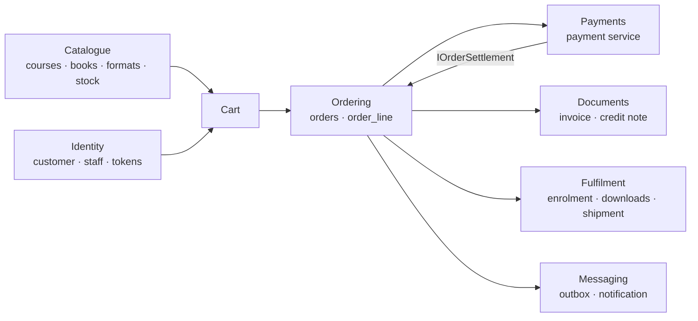
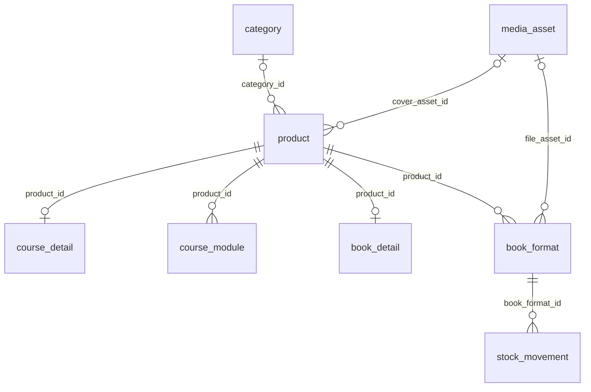
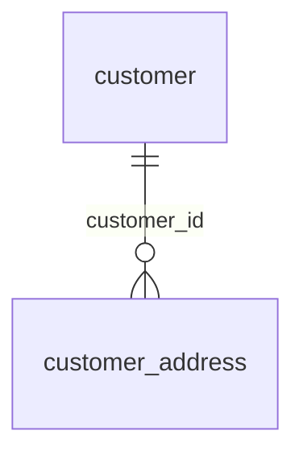
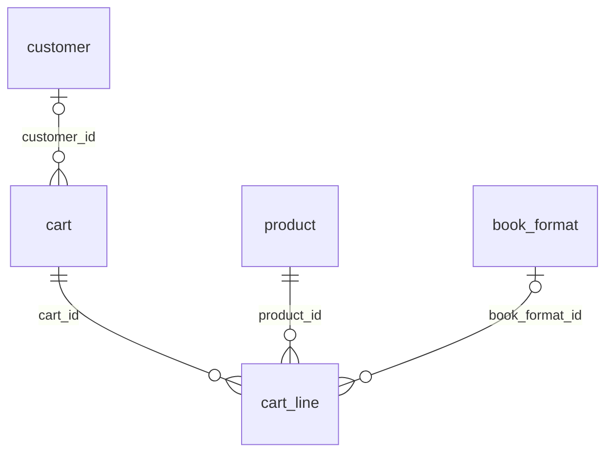
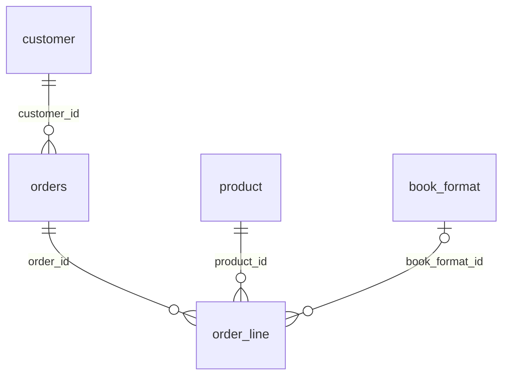
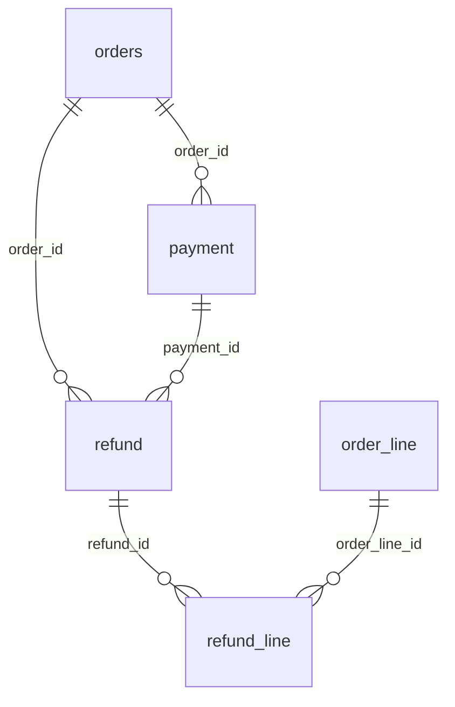
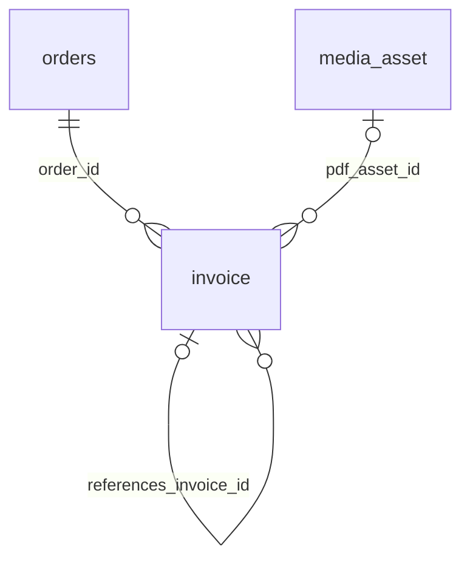
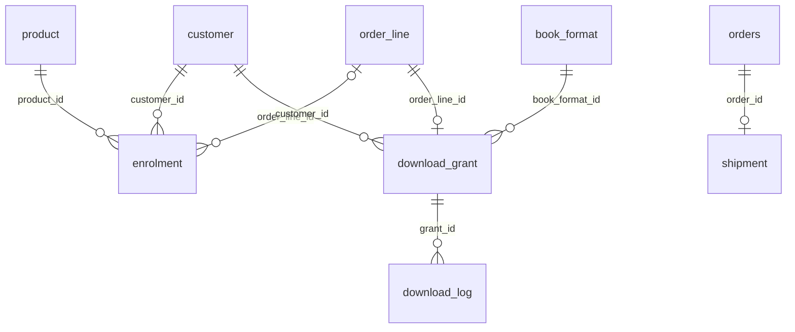
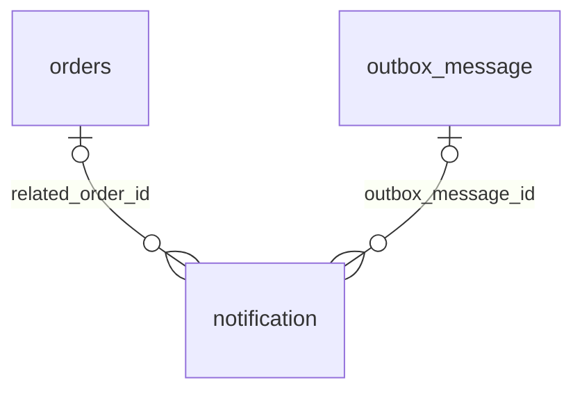
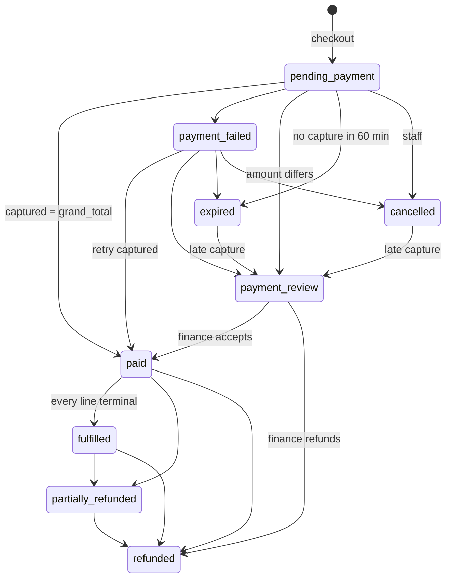

# ta3lom Store — Database Design

**Version:** 2.0 (r4: courses and books only) · **Date:** 13 October 2026 · **Status:** reference design. The reduced DDL was executed and verified on PostgreSQL

> **r4 scope change (13 Oct 2026):** the **giving** feature is removed: sponsorship of seats and copies, pooling, beneficiaries, allocation, zakat, dedication cards and donation causes. The store sells **courses and books only**. 16 tables, 3 views and 1 sequence are dropped, and 11 tables are changed (§14.2). See [scope-change-r4-no-giving.md](../scope-change-r4-no-giving.md).
**Engine:** PostgreSQL 18 · **ORM:** EF Core 10 + Npgsql · **Schema:** `store` · **Currency:** SAR only

| Size | Count |
|---|---|
| Tables | **33** (in 9 domains) |
| Views | 1 (`v_sales_daily`) |
| Sequences | 1 (`order_ref_seq`) + gapless `document_counter` (INV, CN) |
| Functions | 1 (`ar_normalize`) |
| Extensions | `citext`, `pg_trgm` |

**Sources of truth, in order:** the EF Core migrations in `ta3lom_store_api` → `db/reference/001_store_schema.sql` in that repo (master since S-02) → this document.
This document is generated from the r4 reduced schema (`001_store_schema.sql` minus giving) and folds in `database/01–03` and the S-02 decisions. The table catalogue (§6) is generated column by column from that DDL. If it ever disagrees with the migrations, regenerate it.

---

## Contents

1. Design principles
2. Conventions
3. Domain map
4. Entity-relationship diagrams
5. State machines
6. Table catalogue (all 33 tables)
7. Views, functions, sequences
8. Transactions that matter
9. Indexing strategy
10. Security and roles
11. EF Core mapping
12. Operations: jobs, integrity checks, retention, backups
13. Business rules → tables
14. Changes since the S1 draft (incl. r4)

---

## 1. Design principles

1. **The database enforces what it can.** Totals, line amounts, enum values, stock reservation limits and one live enrolment per course are CHECK constraints or partial unique indexes. C# checks first; the database is the last line of defence.
2. **Orders are snapshots.** Titles, prices, VAT and addresses are copied into `orders`, `order_line`, `shipment`. Editing a product never changes history.
3. **Money is exact.** `numeric(12,2)` SAR. `decimal` in C#, never `double`.
4. **Ledgers are the truth; counters give speed.** Print stock has a ledger (`stock_movement`). The counters `book_format.stock_on_hand / stock_reserved` are reconciled against it every night.
5. **Personal data is minimised.** OTP codes and refresh tokens are stored as hashes, IPs as hashes, and the staff TOTP secret is encrypted with Data Protection.
6. **One transaction per business event.** Checkout, settlement and refund each commit atomically, together with their outbox messages.
7. **The store owns its own data.** No shared tables or connections with the main site's MySQL. Integration is over HTTP only.

## 2. Conventions

| Topic | Convention |
|---|---|
| Schema | Everything in `store`. The app's DB user owns only this schema |
| Names | `snake_case`, singular table names (`orders` is the exception, because `order` is reserved). `UseSnakeCaseNamingConvention()` |
| Primary keys | `uuid DEFAULT uuidv7()` (time-ordered). Generated in .NET with `Guid.CreateVersion7()` |
| Ledger keys | `bigint GENERATED ALWAYS AS IDENTITY` (`audit_log`, `stock_movement`, `download_log`, `payment_event`) |
| Enums | `text` + `CHECK (x IN (…))`. C# enums are stored as lower snake_case strings |
| Time | `timestamptz` in UTC. Business dates are read in Asia/Riyadh |
| Bilingual | `*_ar NOT NULL`, `*_en NULL` |
| Concurrency | `xmin` token on `orders`, `book_format` |
| JSON | `jsonb` only for snapshots (addresses), settings, outbox payloads, audit diffs. Each one becomes a typed owned JSON type in the session that first uses it |
| Deletes | Hard delete only for carts, OTPs, drafts and expired technical rows. Financial rows are never deleted |
| Legend in §6 | **Req** ✓ = NOT NULL · `∈ {…}` = CHECK list · `FK→t (cascade)` = ON DELETE behaviour |

---

## 3. Domain map

| Domain | Tables |
|---|---|
| 1. Platform: settings, audit, numbering, media | `setting`, `audit_log`, `document_counter`, `media_asset` |
| 2. Catalogue | `category`, `product`, `course_detail`, `course_module`, `book_detail`, `book_format`, `stock_movement` |
| 3. Identity | `customer`, `customer_address`, `otp_challenge`, `staff_user`, `refresh_token` |
| 4. Cart | `cart`, `cart_line` |
| 5. Ordering | `orders`, `order_line`, `idempotency_key` |
| 6. Payments (owned by the payment service, state-only in the store API) | `payment`, `payment_event`, `refund`, `refund_line` |
| 7. Documents | `invoice` |
| 8. Fulfilment | `enrolment`, `download_grant`, `download_log`, `shipment` |
| 9. Messaging | `outbox_message`, `message_template`, `notification` |



The payment tables exist in the schema, but the store API only reads and writes their **state**. The gateway, webhooks and refunds belong to the separate payment service (doc 15). It calls back through `IOrderSettlement`.

---

## 4. Entity-relationship diagrams

These are generated from the foreign keys. Each diagram shows the tables of one domain and the parents they point to.

#### 2. Catalogue



#### 3. Identity



#### 4. Cart



#### 5. Ordering



#### 6. Payments (owned by the payment service, state-only in the store API)



#### 7. Documents



#### 8. Fulfilment



#### 9. Messaging



---

## 5. State machines

### 5.1 `orders.status` (RUL-29, RUL-35)



Stock is reserved at `pending_payment` and committed at `paid`. It is released at `expired` or `cancelled`, and the lines go back to the active cart.

### 5.2 Other status columns

| Table.column | Values | Notes |
|---|---|---|
| `product.status` | draft → published → archived | `type` can't change after the first order (RUL-01) |
| `order_line.fulfilment_status` | pending, enrolled, pending_sync, available, preparing, shipped, delivered, returned, refunded | Terminal states drive `orders → fulfilled` |
| `enrolment.status` | pending_sync, active, completed, revoked, expired | `ux_enrolment_live` covers pending_sync/active/completed. `source` ∈ purchase, manual |
| `shipment.status` | preparing → shipped → delivered / returned | |
| `cart.status` | active, converted, merged, expired | One active cart per customer (`ux_cart_customer_active`) |
| `customer.status` | active, blocked, anonymised | `blocked` refused at OTP (RUL-61); `anonymised` after account deletion |
| `payment.status` | initiated, authorized, captured, failed, voided, refunded, partially_refunded | Payment service |
| `refund.status` | requested, succeeded, failed | Payment service |
| `notification.status` | queued, sent, failed | `ux_notification_once` stops duplicates |

---

## 6. Table catalogue

### 1. Platform: settings, audit, numbering, media

#### `setting`

Key/value store settings (VAT flag, timeouts, thresholds). Typed in .NET as `StoreSettings`.

| Column | Type | Req | Notes |
|---|---|:-:|---|
| `key` | text | ✓ | PK |
| `value` | jsonb | ✓ |  |
| `updated_at` | timestamptz | ✓ | default now() |
| `updated_by` | text |  |  |

#### `audit_log`

Append-only log of staff-originated changes (EF interceptor).

| Column | Type | Req | Notes |
|---|---|:-:|---|
| `id` | bigint | ✓ | PK · identity |
| `at` | timestamptz | ✓ | default now() |
| `actor` | text | ✓ | staff email / 'system' / 'customer:{id}' |
| `action` | text | ✓ | e.g. product.publish, unit.allocate |
| `entity` | text | ✓ |  |
| `entity_id` | text |  |  |
| `diff` | jsonb |  |  |
| `ip_hash` | char(64) |  |  |

- Index: `ix_audit_entity` (entity, entity_id)
- Index: `ix_audit_at` (at DESC)

#### `document_counter`

Gapless numbering per series (INV, CN) and year; row locked `FOR UPDATE`.

| Column | Type | Req | Notes |
|---|---|:-:|---|
| `series` | text | ✓ | ∈ {INV, CN} |
| `year` | int | ✓ |  |
| `last_value` | int | ✓ | default 0 |

- Constraint: `PRIMARY KEY (series, year)`

#### `media_asset`

Images, PDFs and private book files; alt text required for images.

| Column | Type | Req | Notes |
|---|---|:-:|---|
| `id` | uuid | ✓ | PK |
| `kind` | text | ✓ | ∈ {image, pdf, book_file} |
| `storage_key` | text | ✓ | unique · path under the private/public volume |
| `is_public` | boolean | ✓ | default true · book_file is always private |
| `mime` | text | ✓ |  |
| `size_bytes` | bigint | ✓ | check size_bytes > 0 |
| `width` | int |  |  |
| `height` | int |  |  |
| `alt_ar` | text |  |  |
| `alt_en` | text |  |  |
| `created_at` | timestamptz | ✓ | default now() |

- Constraint: `CONSTRAINT ck_media_alt CHECK (kind <> 'image' OR alt_ar IS NOT NULL)`
- Constraint: `CONSTRAINT ck_media_private_book CHECK (kind <> 'book_file' OR is_public = false)`

### 2. Catalogue

#### `category`

Product categories (chips in the store UI).

| Column | Type | Req | Notes |
|---|---|:-:|---|
| `id` | uuid | ✓ | PK |
| `slug` | text | ✓ | unique · check slug ~ '^[a-z0-9-]{2,60}$' |
| `name_ar` | text | ✓ |  |
| `name_en` | text |  |  |
| `sort` | int | ✓ | default 0 |
| `is_active` | boolean | ✓ | default true |

#### `product`

Shared row for every sellable item: course or book.

| Column | Type | Req | Notes |
|---|---|:-:|---|
| `id` | uuid | ✓ | PK |
| `type` | text | ✓ | ∈ {course, book} |
| `slug` | text | ✓ | unique · check slug ~ '^[a-z0-9-]{2,80}$' |
| `status` | text | ✓ | default 'draft' · ∈ {draft, published, archived} |
| `category_id` | uuid |  | FK→category (set null) |
| `cover_asset_id` | uuid |  | FK→media_asset (set null) |
| `title_ar` | text | ✓ | check length(title_ar) BETWEEN 2 AND 160 |
| `title_en` | text |  |  |
| `summary_ar` | text | ✓ |  |
| `summary_en` | text |  |  |
| `body_ar` | text |  | Markdown (ADR-008 allow-list) |
| `body_en` | text |  |  |
| `badge` | text |  | ∈ {best, new} |
| `sort` | int | ✓ | default 0 |
| `seo_title_ar` | text |  |  |
| `seo_title_en` | text |  |  |
| `seo_desc_ar` | text |  |  |
| `seo_desc_en` | text |  |  |
| `published_at` | timestamptz |  |  |
| `created_at` | timestamptz | ✓ | default now() |
| `updated_at` | timestamptz | ✓ | default now() |
| `search_vector` | tsvector |  | generated |

- Index: `ix_product_listing` (type, status, sort)
- Index: `ix_product_search` gin (search_vector)
- Index: `ix_product_trgm` gin (ar_normalize(title_ar) gin_trgm_ops)

#### `course_detail`

1:1 course details (price, duration, level, LMS id).

| Column | Type | Req | Notes |
|---|---|:-:|---|
| `product_id` | uuid | ✓ | PK · FK→product (cascade) |
| `price` | numeric(12,2) | ✓ | check price >= 0 |
| `compare_at_price` | numeric(12,2) |  | check compare_at_price IS NULL OR compare_at_price > price |
| `lessons` | int | ✓ | default 0 · check lessons >= 0 |
| `duration_minutes` | int | ✓ | default 0 · check duration_minutes >= 0 |
| `level_ar` | text |  |  |
| `level_en` | text |  |  |
| `instructor_ar` | text | ✓ |  |
| `instructor_en` | text |  |  |
| `access_days` | int |  | check access_days IS NULL OR access_days > 0 · NULL = lifetime (RUL-42) |
| `lms_course_ref` | text |  | LMS adapter key (Q-05) |
| `learner_count` | int | ✓ | default 0 · display counter |

#### `course_module`

Course curriculum (ordered modules).

| Column | Type | Req | Notes |
|---|---|:-:|---|
| `id` | uuid | ✓ | PK |
| `product_id` | uuid | ✓ | FK→product (cascade) |
| `sort` | int | ✓ |  |
| `title_ar` | text | ✓ |  |
| `title_en` | text |  |  |
| `duration_seconds` | int | ✓ | default 0 |

- Constraint: `UNIQUE (product_id, sort)`

#### `book_detail`

1:1 book details (author, ISBN, pages).

| Column | Type | Req | Notes |
|---|---|:-:|---|
| `product_id` | uuid | ✓ | PK · FK→product (cascade) |
| `author_ar` | text | ✓ |  |
| `author_en` | text |  |  |
| `pages` | int |  | check pages > 0 |
| `isbn` | text |  |  |
| `published_year` | int |  |  |

#### `book_format`

Print and digital formats of a book with price and stock counters.

| Column | Type | Req | Notes |
|---|---|:-:|---|
| `id` | uuid | ✓ | PK |
| `product_id` | uuid | ✓ | FK→product (cascade) |
| `kind` | text | ✓ | ∈ {print, digital} |
| `sku` | text | ✓ | unique |
| `price` | numeric(12,2) | ✓ | check price >= 0 |
| `compare_at_price` | numeric(12,2) |  | check compare_at_price IS NULL OR compare_at_price > price |
| `is_active` | boolean | ✓ | default true |
| `stock_on_hand` | int |  | check stock_on_hand >= 0 · print only |
| `stock_reserved` | int | ✓ | default 0 · check stock_reserved >= 0 |
| `weight_grams` | int |  |  |
| `low_stock_threshold` | int |  | check low_stock_threshold >= 0 · NULL = setting low_stock_default_threshold |
| `file_asset_id` | uuid |  | FK→media_asset · digital only |

- Constraint: `UNIQUE (product_id, kind)`
- Constraint: `CONSTRAINT ck_format_print CHECK (kind <> 'print' OR stock_on_hand IS NOT NULL)`
- Constraint: `CONSTRAINT ck_format_digital CHECK (kind <> 'digital' OR file_asset_id IS NOT NULL)`
- Constraint: `CONSTRAINT ck_format_reserve CHECK (stock_reserved <= coalesce(stock_on_hand, 0))`

#### `stock_movement`

Append-only stock ledger for print formats.

| Column | Type | Req | Notes |
|---|---|:-:|---|
| `id` | bigint | ✓ | PK · identity |
| `book_format_id` | uuid | ✓ | FK→book_format |
| `delta` | int | ✓ | check delta <> 0 |
| `reason` | text | ✓ | ∈ {restock, sale, return, adjustment} |
| `ref_type` | text |  | order / allocation / manual |
| `ref_id` | text |  |  |
| `note` | text |  |  |
| `at` | timestamptz | ✓ | default now() |
| `actor` | text | ✓ |  |

- Index: `ix_stock_movement_format` (book_format_id, at DESC)

### 3. Identity

#### `customer`

Customer identified by mobile (OTP).

| Column | Type | Req | Notes |
|---|---|:-:|---|
| `id` | uuid | ✓ | PK |
| `mobile` | text | ✓ | unique · check mobile ~ '^\+9665[0-9]{8}$' · E.164 |
| `full_name` | text |  |  |
| `email` | citext |  |  |
| `locale` | char(2) | ✓ | default 'ar' · ∈ {ar, en} |
| `marketing_opt_in` | boolean | ✓ | default false |
| `status` | text | ✓ | default 'active' · ∈ {active, blocked, anonymised} |
| `pdpl_consent_at` | timestamptz |  |  |
| `last_login_at` | timestamptz |  |  |
| `created_at` | timestamptz | ✓ | default now() |
| `updated_at` | timestamptz | ✓ | default now() |

- Index: `ix_customer_email` (email)

#### `customer_address`

Shipping addresses; one default per customer.

| Column | Type | Req | Notes |
|---|---|:-:|---|
| `id` | uuid | ✓ | PK |
| `customer_id` | uuid | ✓ | FK→customer (cascade) |
| `recipient_name` | text | ✓ |  |
| `recipient_mobile` | text | ✓ | check recipient_mobile ~ '^\+9665[0-9]{8}$' |
| `city` | text | ✓ |  |
| `district` | text |  |  |
| `short_address` | text |  | check short_address ~ '^[A-Z]{4}[0-9]{4}$' · Saudi National Address |
| `street` | text |  |  |
| `building_no` | text |  |  |
| `postal_code` | text |  | check postal_code ~ '^[0-9]{5}$' |
| `is_default` | boolean | ✓ | default false |
| `created_at` | timestamptz | ✓ | default now() |

- Index: `ux_address_default` UNIQUE (customer_id) WHERE is_default

#### `otp_challenge`

Hashed OTP codes with attempt counters (deleted after 24 h).

| Column | Type | Req | Notes |
|---|---|:-:|---|
| `id` | uuid | ✓ | PK |
| `mobile` | text | ✓ |  |
| `purpose` | text | ✓ | ∈ {login} |
| `code_hash` | char(64) | ✓ | HMAC-SHA256(code, server pepper) |
| `attempts` | smallint | ✓ | default 0 |
| `expires_at` | timestamptz | ✓ |  |
| `consumed_at` | timestamptz |  |  |
| `ip_hash` | char(64) |  |  |
| `created_at` | timestamptz | ✓ | default now() |

- Index: `ix_otp_mobile_recent` (mobile, created_at DESC)

#### `staff_user`

Admin users: email + password + TOTP, roles array.

| Column | Type | Req | Notes |
|---|---|:-:|---|
| `id` | uuid | ✓ | PK |
| `email` | citext | ✓ | unique |
| `name` | text | ✓ |  |
| `pass_hash` | text | ✓ | ASP.NET Core PasswordHasher v3 (PBKDF2) or Argon2id |
| `totp_secret_enc` | bytea |  | Data Protection-encrypted; NULL until enrolled |
| `roles` | text[] | ✓ | default '{viewer}' · check roles <@ ARRAY['admin','store_manager','finance','fulfilment','viewer']::text[] |
| `failed_count` | int | ✓ | default 0 |
| `locked_until` | timestamptz |  |  |
| `is_active` | boolean | ✓ | default true |
| `last_login_at` | timestamptz |  |  |
| `created_at` | timestamptz | ✓ | default now() |

#### `refresh_token`

Rotating refresh tokens for customers and staff, with family for reuse detection.

| Column | Type | Req | Notes |
|---|---|:-:|---|
| `id` | uuid | ✓ | PK |
| `subject_type` | text | ✓ | ∈ {customer, staff} |
| `subject_id` | uuid | ✓ |  |
| `token_hash` | char(64) | ✓ | unique · SHA-256; raw token only in the cookie |
| `family_id` | uuid | ✓ | reuse detection revokes the family |
| `expires_at` | timestamptz | ✓ |  |
| `revoked_at` | timestamptz |  |  |
| `replaced_by` | uuid |  |  |
| `created_at` | timestamptz | ✓ | default now() |
| `user_agent` | text |  |  |

- Index: `ix_refresh_subject` (subject_type, subject_id)

### 4. Cart

#### `cart`

Guest (cookie) or customer cart.

| Column | Type | Req | Notes |
|---|---|:-:|---|
| `id` | uuid | ✓ | PK · opaque id in the HttpOnly cookie |
| `customer_id` | uuid |  | FK→customer (cascade) |
| `status` | text | ✓ | default 'active' · ∈ {active, converted, merged, expired} |
| `expires_at` | timestamptz |  | guests only (RUL-16) |
| `created_at` | timestamptz | ✓ | default now() |
| `updated_at` | timestamptz | ✓ | default now() |

- Index: `ux_cart_customer_active` UNIQUE (customer_id) WHERE status = 'active' AND customer_id IS NOT NULL

#### `cart_line`

Cart lines: a course, or a book format with quantity.

| Column | Type | Req | Notes |
|---|---|:-:|---|
| `id` | uuid | ✓ | PK |
| `cart_id` | uuid | ✓ | FK→cart (cascade) |
| `product_id` | uuid | ✓ | FK→product |
| `book_format_id` | uuid |  | FK→book_format |
| `quantity` | int | ✓ | default 1 · check quantity BETWEEN 1 AND 999 |
| `unit_price` | numeric(12,2) | ✓ | check unit_price >= 0 · indicative (RUL-15) |
| `amount` | numeric(12,2) | ✓ | check amount > 0 |
| `added_at` | timestamptz | ✓ | default now() |

- Constraint: `CONSTRAINT ck_cart_amount CHECK (amount = unit_price * quantity)`
- Index: `ix_cart_line_cart` (cart_id)

### 5. Ordering

#### `orders`

Order header with totals snapshot, contact, shipping address, status.

| Column | Type | Req | Notes |
|---|---|:-:|---|
| `id` | uuid | ✓ | PK |
| `reference` | text | ✓ | unique · T3-26-001234 (RUL-28) |
| `customer_id` | uuid | ✓ | FK→customer |
| `status` | text | ✓ | default 'pending_payment' · ∈ {pending_payment, paid, payment_failed, payment_review, expired,  cancelled, fulfilled, partially_refunded, refunded} |
| `currency` | char(3) | ✓ | default 'SAR' · check currency = 'SAR' |
| `purchases_total` | numeric(12,2) | ✓ | default 0 |
| `shipping_total` | numeric(12,2) | ✓ | default 0 |
| `vat_total` | numeric(12,2) | ✓ | default 0 · informational: included in purchases/shipping |
| `grand_total` | numeric(12,2) | ✓ | check grand_total > 0 |
| `refunded_total` | numeric(12,2) | ✓ | default 0 |
| `locale` | char(2) | ✓ | default 'ar' |
| `contact_name` | text | ✓ |  |
| `contact_mobile` | text | ✓ |  |
| `contact_email` | citext | ✓ |  |
| `shipping_address` | jsonb |  | snapshot; required if a print line exists |
| `source_cart_id` | uuid |  |  |
| `terms_accepted_at` | timestamptz | ✓ | FR-S30, E-Commerce Law evidence |
| `placed_at` | timestamptz | ✓ | default now() |
| `payment_due_at` | timestamptz | ✓ | placed_at + timeout (RUL-29) |
| `paid_at` | timestamptz |  |  |
| `fulfilled_at` | timestamptz |  |  |
| `cancelled_at` | timestamptz |  |  |

- Constraint: `CONSTRAINT ck_order_total CHECK (grand_total = purchases_total + shipping_total)`
- Index: `ix_order_customer` (customer_id, placed_at DESC)
- Index: `ix_order_status` (status, placed_at)
- Index: `ix_order_due` (payment_due_at) WHERE status IN ('pending_payment','payment_failed')

#### `order_line`

Snapshot of each purchased line at order time; drives every settlement effect.

| Column | Type | Req | Notes |
|---|---|:-:|---|
| `id` | uuid | ✓ | PK |
| `order_id` | uuid | ✓ | FK→orders (cascade) |
| `line_no` | smallint | ✓ |  |
| `product_id` | uuid | ✓ | FK→product |
| `product_type` | text | ✓ | ∈ {course, book} |
| `book_format_id` | uuid |  | FK→book_format |
| `quantity` | int | ✓ | check quantity BETWEEN 1 AND 999 |
| `unit_price` | numeric(12,2) | ✓ |  |
| `amount` | numeric(12,2) | ✓ | check amount > 0 |
| `vat_rate` | numeric(5,2) | ✓ | default 0 |
| `vat_amount` | numeric(12,2) | ✓ | default 0 |
| `title_ar` | text | ✓ | snapshot at order time |
| `title_en` | text |  |  |
| `fulfilment_status` | text | ✓ | default 'pending' · ∈ {pending, enrolled, pending_sync, available, preparing, shipped, delivered,  returned, refunded} |
| `refunded_amount` | numeric(12,2) | ✓ | default 0 |

- Constraint: `UNIQUE (order_id, line_no)`
- Constraint: `CONSTRAINT ck_line_amount CHECK (amount = unit_price * quantity)`
- Constraint: `CONSTRAINT ck_line_refund CHECK (refunded_amount <= amount)`
- Index: `ix_order_line_product` (product_id)

#### `idempotency_key`

Stored responses for `Idempotency-Key` on checkout and refunds.

| Column | Type | Req | Notes |
|---|---|:-:|---|
| `key` | text | ✓ |  |
| `scope` | text | ✓ | e.g. checkout:{customerId}, refund:{staffId} |
| `request_hash` | char(64) | ✓ | SHA-256 of the canonical request body |
| `status_code` | int |  |  |
| `response` | jsonb |  |  |
| `created_at` | timestamptz | ✓ | default now() |

- Constraint: `PRIMARY KEY (scope, key)`
- Index: `ix_idempotency_created` (created_at)

### 6. Payments (owned by the payment service, state-only in the store API)

#### `payment`

Payment attempt per order (hosted page).

| Column | Type | Req | Notes |
|---|---|:-:|---|
| `id` | uuid | ✓ | PK |
| `order_id` | uuid | ✓ | FK→orders |
| `provider` | text | ✓ | moyasar \| hyperpay \| tap … (Q-01) |
| `provider_payment_id` | text |  |  |
| `method` | text |  | ∈ {mada, applepay, card, stcpay, bnpl} |
| `amount` | numeric(12,2) | ✓ | check amount > 0 |
| `status` | text | ✓ | default 'initiated' · ∈ {initiated, authorized, captured, failed, voided, refunded, partially_refunded} |
| `failure_code` | text |  |  |
| `failure_message` | text |  |  |
| `created_at` | timestamptz | ✓ | default now() |
| `updated_at` | timestamptz | ✓ | default now() |

- Constraint: `UNIQUE (provider, provider_payment_id)`
- Index: `ix_payment_order` (order_id)
- Index: `ix_payment_reconcile` (status, created_at) WHERE status = 'initiated'

#### `payment_event`

Webhook inbox; unique per provider event (idempotency).

| Column | Type | Req | Notes |
|---|---|:-:|---|
| `id` | bigint | ✓ | PK · identity |
| `provider` | text | ✓ |  |
| `provider_event_id` | text | ✓ |  |
| `event_type` | text | ✓ |  |
| `signature_valid` | boolean | ✓ |  |
| `payload` | jsonb | ✓ |  |
| `received_at` | timestamptz | ✓ | default now() |
| `processed_at` | timestamptz |  |  |
| `error` | text |  |  |

- Constraint: `UNIQUE (provider, provider_event_id)`

#### `refund`

Refund header against a payment.

| Column | Type | Req | Notes |
|---|---|:-:|---|
| `id` | uuid | ✓ | PK |
| `order_id` | uuid | ✓ | FK→orders |
| `payment_id` | uuid | ✓ | FK→payment |
| `amount` | numeric(12,2) | ✓ | check amount > 0 |
| `reason` | text | ✓ |  |
| `status` | text | ✓ | default 'requested' · ∈ {requested, succeeded, failed} |
| `provider_refund_id` | text |  |  |
| `requested_by` | text | ✓ | staff email (finance role) |
| `created_at` | timestamptz | ✓ | default now() |
| `completed_at` | timestamptz |  |  |

#### `refund_line`

Refunded amount per order line.

| Column | Type | Req | Notes |
|---|---|:-:|---|
| `refund_id` | uuid | ✓ | FK→refund (cascade) |
| `order_line_id` | uuid | ✓ | FK→order_line |
| `amount` | numeric(12,2) | ✓ | check amount > 0 |

- Constraint: `PRIMARY KEY (refund_id, order_line_id)`

### 7. Documents

#### `invoice`

Sales invoice / credit note (INV / CN), the only financial document.

| Column | Type | Req | Notes |
|---|---|:-:|---|
| `id` | uuid | ✓ | PK |
| `order_id` | uuid | ✓ | FK→orders |
| `kind` | text | ✓ | ∈ {invoice, credit_note} |
| `number` | text | ✓ | unique · INV-2026-000001 / CN-2026-000001 |
| `issued_at` | timestamptz | ✓ | default now() |
| `is_tax_invoice` | boolean | ✓ | vat_enabled at issue time |
| `seller_vat_no` | text |  |  |
| `net_total` | numeric(12,2) | ✓ |  |
| `vat_total` | numeric(12,2) | ✓ |  |
| `gross_total` | numeric(12,2) | ✓ | check gross_total = net_total + vat_total |
| `references_invoice_id` | uuid |  | FK→invoice · credit note → original |
| `pdf_asset_id` | uuid |  | FK→media_asset |
| `zatca_uuid` | uuid |  | ZATCA Phase 2 (S2) — populated by the e-invoicing adapter |
| `zatca_icv` | bigint |  | invoice counter value |
| `zatca_pih` | text |  | previous invoice hash |
| `zatca_hash` | text |  |  |
| `zatca_qr` | text |  | TLV base64 |
| `zatca_status` | text |  | ∈ {not_required, pending, reported, cleared, rejected} |

- Index: `ix_invoice_order` (order_id)

### 8. Fulfilment

#### `enrolment`

Course access: purchased or granted manually; one live per customer per course.

| Column | Type | Req | Notes |
|---|---|:-:|---|
| `id` | uuid | ✓ | PK |
| `customer_id` | uuid | ✓ | FK→customer |
| `product_id` | uuid | ✓ | FK→product |
| `source` | text | ✓ | ∈ {purchase, manual} |
| `order_line_id` | uuid |  | FK→order_line · purchase |
| `status` | text | ✓ | default 'active' · ∈ {pending_sync, active, completed, revoked, expired} |
| `progress_pct` | smallint | ✓ | default 0 · check progress_pct BETWEEN 0 AND 100 |
| `lms_enrolment_ref` | text |  |  |
| `granted_at` | timestamptz | ✓ | default now() |
| `expires_at` | timestamptz |  |  |
| `started_at` | timestamptz |  |  |
| `completed_at` | timestamptz |  |  |
| `certificate_no` | text |  | unique |

- Constraint: `CONSTRAINT ck_enrol_source CHECK ( (source = 'purchase' AND order_line_id IS NOT NULL) OR (source = 'manual'))`
- Index: `ux_enrolment_live` UNIQUE (customer_id, product_id) WHERE status IN ('pending_sync','active','completed')

#### `download_grant`

Right to download a digital book (limit, revocation).

| Column | Type | Req | Notes |
|---|---|:-:|---|
| `id` | uuid | ✓ | PK |
| `customer_id` | uuid | ✓ | FK→customer |
| `order_line_id` | uuid | ✓ | FK→order_line · unique |
| `book_format_id` | uuid | ✓ | FK→book_format |
| `max_downloads` | int | ✓ | default 5 |
| `download_count` | int | ✓ | default 0 |
| `revoked_at` | timestamptz |  |  |
| `created_at` | timestamptz | ✓ | default now() |

- Constraint: `CHECK (download_count <= max_downloads)`

#### `download_log`

Each download with watermark reference.

| Column | Type | Req | Notes |
|---|---|:-:|---|
| `id` | bigint | ✓ | PK · identity |
| `grant_id` | uuid | ✓ | FK→download_grant |
| `at` | timestamptz | ✓ | default now() |
| `ip_hash` | char(64) |  |  |

#### `shipment`

One shipment per order for print lines: address snapshot, carrier, tracking, status.

| Column | Type | Req | Notes |
|---|---|:-:|---|
| `id` | uuid | ✓ | PK |
| `order_id` | uuid | ✓ | FK→orders · unique |
| `status` | text | ✓ | default 'preparing' · ∈ {preparing, shipped, delivered, returned} |
| `carrier` | text |  |  |
| `tracking_no` | text |  |  |
| `address` | jsonb | ✓ |  |
| `shipped_at` | timestamptz |  |  |
| `delivered_at` | timestamptz |  |  |
| `updated_by` | text |  |  |

### 9. Messaging

#### `outbox_message`

Transactional outbox; dispatched after commit.

| Column | Type | Req | Notes |
|---|---|:-:|---|
| `id` | uuid | ✓ | PK |
| `type` | text | ✓ | OrderPaid, RenderDocuments, LmsEnrol … |
| `payload` | jsonb | ✓ |  |
| `occurred_at` | timestamptz | ✓ | default now() |
| `processed_at` | timestamptz |  |  |
| `attempts` | int | ✓ | default 0 |
| `next_attempt_at` | timestamptz | ✓ | default now() |
| `last_error` | text |  |  |

- Index: `ix_outbox_pending` (next_attempt_at) WHERE processed_at IS NULL

#### `message_template`

Bilingual SMS/email templates (Scriban).

| Column | Type | Req | Notes |
|---|---|:-:|---|
| `key` | text | ✓ |  |
| `channel` | text | ✓ | ∈ {sms, email} |
| `locale` | char(2) | ✓ | ∈ {ar, en} |
| `subject` | text |  |  |
| `body` | text | ✓ | Scriban/Liquid template |
| `updated_at` | timestamptz | ✓ | default now() |

- Constraint: `PRIMARY KEY (key, channel, locale)`

#### `notification`

Each SMS/email sent; unique per outbox message, channel and recipient.

| Column | Type | Req | Notes |
|---|---|:-:|---|
| `id` | uuid | ✓ | PK |
| `channel` | text | ✓ | ∈ {sms, email} |
| `recipient` | text | ✓ |  |
| `template_key` | text | ✓ |  |
| `locale` | char(2) | ✓ |  |
| `status` | text | ✓ | default 'queued' · ∈ {queued, sent, failed} |
| `provider_msg_id` | text |  |  |
| `error` | text |  |  |
| `related_order_id` | uuid |  | FK→orders |
| `outbox_message_id` | uuid |  | FK→outbox_message · dedupe: a retried outbox message never re-sends |
| `created_at` | timestamptz | ✓ | default now() |
| `sent_at` | timestamptz |  |  |

- Index: `ux_notification_once` UNIQUE (outbox_message_id, channel, recipient) WHERE outbox_message_id IS NOT NULL
- Index: `ix_notification_order` (related_order_id)

---

## 7. Views, functions, sequences

### 7.1 View

| View | Purpose | Built from |
|---|---|---|
| `v_sales_daily` | Sales and VAT per Riyadh day and product type (orders, gross, VAT, refunded) | paid `orders` × `order_line` |

Stock levels are read directly from `book_format` (`stock_on_hand − stock_reserved`). No view is needed.

### 7.2 Function

`ar_normalize(text)` is `IMMUTABLE` and `PARALLEL SAFE`. It removes tashkeel and tatweel, unifies أ/إ/آ/ٱ → ا, ة → ه and ى → ي, and lower-cases Latin text. It feeds `product.search_vector` and the trigram index. Search input goes through the same function, so «مدرسه» finds «مدرسة».

### 7.3 Numbering

| Number | Format | Mechanism | Gaps |
|---|---|---|---|
| Order reference | `T3-YY-NNNNNN` | `order_ref_seq` (starts at 1000) | Allowed |
| Invoice / credit note | `INV-YYYY-n`, `CN-YYYY-n` | `document_counter (series, year)` row locked `FOR UPDATE` inside settlement / refund | **None** (integrity check 5) |

---

## 8. Transactions that matter

### 8.1 Checkout (order creation)

```
BEGIN
  SELECT … FROM book_format WHERE id = ANY(@print) FOR UPDATE;
  UPDATE book_format SET stock_reserved += @q WHERE id=@f AND stock_on_hand - stock_reserved >= @q;  -- 0 rows ⇒ out of stock
  reject a course the customer already owns or has in an unpaid order (RUL-13)
  INSERT orders (reference from order_ref_seq, purchases_total, shipping_total, vat_total, contact, address snapshot, payment_due_at);
  INSERT order_line … (repriced from the catalogue, never from cart_line.unit_price);
  UPDATE cart SET status='converted';  store idempotency_key response
COMMIT  → IPaymentInitiator (payment service, outside the transaction)
```

### 8.2 Settlement (`IOrderSettlement`, the critical unit of work)

```
BEGIN
  SELECT * FROM orders WHERE id=@o FOR UPDATE;                 -- serialise per order
  already paid → AlreadyPaid; amount ≠ grand_total or order expired/cancelled → payment_review + FinanceAlert
  UPDATE orders SET status='paid', paid_at=now();
  per line (ILineSettlementEffect):
    course   → enrolment (ux_enrolment_live blocks doubles → line flagged for refund + FinanceAlert)
    digital  → download_grant
    print    → stock_on_hand −q, stock_reserved −q, stock_movement 'sale', shipment upsert
  document_counter ('INV', year) FOR UPDATE → INSERT invoice
  outbox OrderPaid, RenderDocuments, LmsEnrol
COMMIT   -- SMS, email, PDF, LMS happen after commit, from the outbox
```

It retries on serialization failure. Before calling this, the payment service writes its own `payment_event` row with `ON CONFLICT DO NOTHING`.

### 8.3 Expiry (`ExpireUnpaidOrders`)

`pending_payment` / `payment_failed` orders past `payment_due_at` become `expired`. Reserved stock is released, and the lines are restored to the customer's active cart unless the product is already there (RUL-29/30).

### 8.4 Refund (payment service, RUL-57/58)

One transaction: `refund` + `refund_line`, `order_line.refunded_amount`, `orders.refunded_total` and status, enrolment `revoked` (outbox `LmsRevoke`), `download_grant.revoked_at`, print stock returned through `stock_movement` 'return' when goods come back. A credit note is issued (`CN` series).

---

## 9. Indexing strategy

| Query | Index |
|---|---|
| Catalogue listing | `ix_product_listing (type, status, sort)` |
| Arabic / English search | `ix_product_search` GIN on generated `tsvector`; `ix_product_trgm` GIN trigram on `ar_normalize(title_ar)` |
| Customer's orders | `ix_order_customer (customer_id, placed_at DESC)` |
| Expiry job | partial `ix_order_due … WHERE status IN ('pending_payment','payment_failed')` |
| Reconciliation | partial `ix_payment_reconcile … WHERE status='initiated'` |
| Outbox worker | partial `ix_outbox_pending (next_attempt_at) WHERE processed_at IS NULL` |
| Business uniqueness | `ux_enrolment_live`, `ux_address_default`, `ux_cart_customer_active`, `ux_notification_once`, `book_format (product_id, kind)` |

**Year-1 volume:** under 50k orders and 150k lines. One VPS PostgreSQL handles this easily. No partitioning is needed until about 5M rows in `audit_log` or `outbox_message`, and retention keeps both small.

---

## 10. Security and roles

| Control | Implementation |
|---|---|
| DB roles | `store_owner`: migrations only (CI). `store_app`: DML on `store.*`, no DDL. `store_report`: read-only on views |
| Append-only | `audit_log`, `stock_movement`: `store_app` gets `INSERT, SELECT` only |
| `payment_event` | `INSERT, SELECT` plus a **column-level** `UPDATE (processed_at, error, payload)`. Decision r2, migration `GrantPaymentEventColumnUpdate` |
| Staff roles | `admin`, `store_manager`, `finance`, `fulfilment`, `viewer` (`allocation_officer` removed in r4) |
| Encryption | `staff_user.totp_secret_enc` (`bytea`, Data Protection). Private book files are stored outside the public volume |
| Secrets never stored | OTP codes and refresh tokens are stored only as SHA-256/HMAC hashes. Passwords use PBKDF2/Argon2id. IPs are hashed |
| Network | PostgreSQL is reachable on the Docker network only. Admin access is over an SSH tunnel |
| Audit | A `SaveChangesInterceptor` writes `audit_log` with a JSON diff for every staff change |

---

## 11. EF Core mapping

| DB | C# |
|---|---|
| `uuid` | `Guid` (`Guid.CreateVersion7()`) |
| `numeric(12,2)` | `decimal` + `HasPrecision(12,2)`; `Money` value object in Domain |
| `text` + CHECK | `enum` + string converter; CHECK via `HasCheckConstraint` |
| `timestamptz` / `date` | `DateTimeOffset` (UTC) / `DateOnly`, always from `IClock` |
| `jsonb` | `OwnsOne(…).ToJson()` typed snapshots (`ShippingAddress`); settings via typed `StoreSettings` |
| `text[]` | `string[]` (staff roles) |
| `citext` | `string` + `HasColumnType("citext")` |
| encrypted `bytea` | `string` in Domain; `ValueConverter` calling `IDataProtector` |
| `xmin` | `uint RowVersion` + `IsRowVersion()` |
| generated `tsvector` | shadow `NpgsqlTsVector`, `HasComputedColumnSql(…, stored: true)` |
| view | keyless entity `ToView("v_sales_daily")` |
| partial unique index | `HasIndex(…).IsUnique().HasFilter("…")` |

There's one `IEntityTypeConfiguration<T>` per table under `Infrastructure/Persistence/Configurations/`. Migrations are never applied at startup. CI generates `migrate.sql`, and the deploy step applies it. A schema-parity test diffs the migration script against `db/reference/001_store_schema.sql`.

---

## 12. Operations

### 12.1 Jobs that touch the database (Quartz.NET)

| Job | Schedule (Riyadh) | Effect |
|---|---|---|
| `OutboxDispatcher` | continuous, 1 s poll, `SKIP LOCKED` | Notifications, PDFs, LMS sync; backoff up to 24 h |
| `ExpireUnpaidOrders` | every 5 min | → `expired`, release stock, restore cart |
| `ExpireGuestCarts` | 03:00 | Delete guest carts past `expires_at` |
| `IntegrityChecks` | 04:00 | §12.2; any row → staff alert |
| `LowStockAlert` | 08:00 | Print formats at or below their threshold (default 20) |
| `LmsProgressSync` | hourly | Progress / completion → `enrolment`, certificate number |
| `PruneIdempotencyKeys`, `PruneOtp` | hourly | Delete rows older than 24 h |
| `Retention` | weekly | §12.3 |
| `ReconcilePayments` | every 5 min | **Payment service** |

That is **8 scheduled jobs + the dispatcher** in the store API (was 12). `CloseCampaigns`, `AllocationAlerts`, `LapseUnits` and `SponsorDigest` are removed.

### 12.2 Nightly integrity checks (each must return 0 rows)

1. Order totals = Σ lines + shipping (`purchases_total = Σ order_line.amount`)
2. Paid orders have captured payments = `grand_total`
3. `book_format.stock_on_hand` = Σ `stock_movement.delta`
4. Every paid order has its invoice
5. Invoice and credit-note numbers are gapless per series and year

The old checks 4–7 (pool, units, goal counters, zakat) are deleted. `db/reference/003_integrity_checks.sql` must be trimmed to match.

### 12.3 Retention (PDPL)

| Data | Kept | Then |
|---|---|---|
| Orders, lines, payments, invoices | 10 years | Customer identity anonymised on account deletion |
| `payment_event.payload` | 18 months | Replaced by `{}` |
| `otp_challenge` / `idempotency_key` | 24 h | Deleted |
| Guest carts | 30 days idle | Deleted |
| `notification`, `download_log`, IP hashes | 12 months | Deleted |
| Processed `outbox_message` | 30 days | Deleted |
| `audit_log` | 5 years | Kept |

### 12.4 Backups

| What | How | Frequency |
|---|---|---|
| Logical dump | `pg_dump -Fc`, encrypted with `age`, stored off-server | every 6 h (14 days + 12 monthly) |
| PITR | `pgBackRest` WAL archive | continuous (7 days) |
| Files (book PDFs, invoices, images) + Data Protection key ring | `restic` | daily |

Targets: RPO ≤ 15 min, RTO ≤ 4 h, with a monthly restore drill on staging.
Sizing (KVM 2, 2 vCPU / 8 GB): `shared_buffers 2GB`, `effective_cache_size 5GB`, `work_mem 16MB`, `max_connections 100`, Npgsql pool 40.

---

## 13. Business rules → tables

| Rules | Area | Enforced by |
|---|---|---|
| RUL-01…05 | Catalogue | `product.type ∈ {course, book}` and status CHECKs, `book_format` CHECKs and `(product_id, kind)` unique |
| RUL-11…18 | Cart | `cart_line` CHECKs (`ck_cart_amount`), `ux_cart_customer_active` |
| RUL-13 | One live enrolment | `ux_enrolment_live` |
| RUL-24…31 | Ordering | `order_line` snapshots, `ck_order_total`, `ck_line_amount`, `order_ref_seq`, stock reservation |
| RUL-32…38 | Payments | `payment`, `payment_event` unique per provider event (payment service) |
| RUL-39…42 | Fulfilment | `enrolment`, `download_grant`, `shipment`, `stock_movement` |
| RUL-56…59 | Refunds and documents | `refund`, `refund_line`, `ck_line_refund`, `document_counter`, `invoice` |
| RUL-60…62 | Identity | `otp_challenge`, `refresh_token` families, `customer.status`, `staff_user.roles` |
| RUL-63 | Messages | `outbox_message`, `message_template`, `notification` + `ux_notification_once` |

Removed in r4: RUL-06…10, RUL-19…23, RUL-43…55.

---

## 14. Changes since the S1 draft (29 Sep 2026)

### 14.1 S-02 decisions (30 Sep)

| # | Change |
|---|---|
| 1 | `payment_event`: column-level `UPDATE (processed_at, error, payload)` for `store_app` (PR #5) |
| 2 | Constraint names follow the DDL (`orders_status_check`, …) |
| 3 | Seed inserts use `ON CONFLICT DO NOTHING`; `db/reference/` in the repo is the master copy |
| 4 | Setting `low_stock_default_threshold = 20` seeded |
| 5 | jsonb columns become typed owned JSON types when first used (`orders.shipping_address` S-15, `shipment.address` S-21, `setting.value` S-09) |
| 6 | `payment*` / `refund*` tables are state-only in the store API (plan 14 §0) |

### 14.2 r4 — giving removed (13 Oct)

**Dropped tables (16):** `sponsorship_offer`, `cause_detail`, `goal_progress`, `goal_adjustment`, `cause_update`, `dedication`, `donation_receipt`, `beneficiary`, `allocation_batch`, `sponsored_unit`, `sponsored_unit_event`, `sponsorship_pool`, `pool_contribution`, `unit_funding`, `distribution`, `zakat_ledger`.
**Dropped views (3):** `v_goal`, `v_allocation_backlog`, `v_zakat_balance`. **Dropped sequence:** `beneficiary_code_seq`. **Dropped FK:** `fk_enrolment_unit`.

**Changed tables (11):**

| Table | Change |
|---|---|
| `document_counter` | `series ∈ {INV, CN}` (DR, DRC removed) |
| `product` | `type ∈ {course, book}`; `badge ∈ {best, new}` (`urgent` was for causes) |
| `stock_movement` | `reason` loses `sponsor_distribution` |
| `customer` | drop `anonymous_default` |
| `otp_challenge` | `purpose ∈ {login}` (`beneficiary_invite` removed) |
| `staff_user` | `roles` lose `allocation_officer` |
| `cart_line` | drop `kind`, `mode`, `intent`, `dedication`; new `ck_cart_amount (amount = unit_price × quantity)` |
| `orders` | drop `gifts_total`, `is_anonymous`; `ck_order_total`: `grand_total = purchases_total + shipping_total` |
| `order_line` | drop `kind`, `mode`, `intent`, `sponsorship_offer_id`; `product_type ∈ {course, book}`; `fulfilment_status` loses `funded`, `received`; new `ck_line_amount`; `ck_line_buy_vat`, `ck_line_intent`, `ck_line_offer` dropped; index `ix_order_line_product (product_id)` |
| `refund_line` | drop `units` |
| `enrolment` | `source ∈ {purchase, manual}`; drop `sponsored_unit_id` |
| `v_sales_daily` | grouped by day and product type (no `kind`) |

**Migration (in the repo, not by hand):** one new EF migration `RemoveGiving`, never an edit to a merged one. Order: drop views → drop FK `fk_enrolment_unit` → drop giving tables (children first) → alter the 11 tables → recreate `v_sales_daily` → update `db/reference/001–003` and the schema-parity snapshot. The seed (`002`) loses causes, offers, beneficiaries, gift templates and settings (`min_gift_amount`, `dedication_*`, `allocation_*`, `lapse_days`, `pool_*`, `general_fund_*`). The store isn't live, so no data is migrated.
